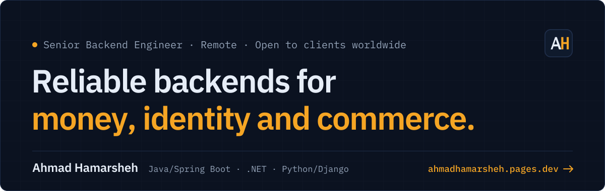

<a href="https://ahmadhamarsheh.pages.dev">
  <picture>
    <source media="(prefers-color-scheme: dark)" srcset="assets/banner-dark.svg">
    <source media="(prefers-color-scheme: light)" srcset="assets/banner-light.svg">
    
  </picture>
</a>

<p align="center">
  <a href="https://ahmadhamarsheh.pages.dev"><b>Portfolio</b></a>&nbsp;&nbsp;·&nbsp;&nbsp;<a href="https://ahmadhamarsheh.pages.dev/ar/">العربية</a>&nbsp;&nbsp;·&nbsp;&nbsp;<a href="https://ahmadhamarsheh.pages.dev/cv/Ahmad-Hamarsheh-CV.pdf">CV (PDF)</a>&nbsp;&nbsp;·&nbsp;&nbsp;<a href="https://www.linkedin.com/in/ahmadhamarsheh">LinkedIn</a>&nbsp;&nbsp;·&nbsp;&nbsp;<a href="https://ahmadhamarsheh.pages.dev/#contact">Contact</a>
</p>

I'm Ahmad. Since 2021 I've built payment, payout, KYC and e-commerce integration systems in Java/Spring Boot, .NET and Python/Django — for US fintech clients, a telecom operator, a logistics company and, today, Apple.

Most of my production work lives in private client repositories, so I write it up as case studies on my site: the problem, the architecture and the results — without confidential code or data.

### Selected work

**[Payment gateways & KYC at Jawwal →](https://ahmadhamarsheh.pages.dev/work/jawwal-payments-kyc/)**<br>
Bills, top-ups and government identity checks for 150,000+ subscribers.<br>
**150,000+** subscribers served · **~10% faster** responses on tuned SQL paths · **thousands** of payment transactions a day<br>
`.NET Core` `C#` `Oracle` `REST` `Prometheus` `Grafana`

**[Earnings & payout engine for a US fintech rewards platform →](https://ahmadhamarsheh.pages.dev/work/fintech-earnings-payouts/)**<br>
A multi-level referral network, an earnings engine and ledger-style payouts — rolled out white-label for a Latin American distributor.<br>
**Backend lead** on the platform · every earning and payout **traceable** as a ledger entry · **multi-tenant** white-label launch<br>
`Python` `Django/DRF` `PostgreSQL` `Celery` `Kubernetes (GKE)`

**[Resilient Salla & Zid integrations at Logestechs →](https://ahmadhamarsheh.pages.dev/work/salla-zid-integrations/)**<br>
Store orders flowing into shipment tracking and inventory — even when a third-party API is slow or down.<br>
**~15%** lower API p95 latency · **~20%** lower database load · **10+** high-traffic endpoints tuned<br>
`Java` `Spring Boot` `MySQL` `RabbitMQ` `Redis` `Resilience4j`

### Stack

```text
backend    Java/Spring Boot · .NET · Python/Django
data       PostgreSQL · SQL Server · Oracle · MySQL · Redis
infra      Docker · Kubernetes (GKE) · RabbitMQ · CI/CD
domains    Payments · payouts · KYC · telecom · logistics
```

### Public code

**[Portfolio](https://github.com/ahmadhamarsheh/Portfolio)** — the source of my site: a static Astro build, a contact API on Cloudflare Pages Functions built as ports & adapters (Resend, Turnstile, KV rate limiting), and CI that blocks a merge on any failed check.

---

<sub>Experience: Apple · Logestechs · Jawwal · Road9 · FinPrivado &nbsp;·&nbsp; M.Tech in Cyber Security &nbsp;·&nbsp; Arabic (native) · English (fluent) &nbsp;·&nbsp; Remote — open to clients worldwide</sub>
